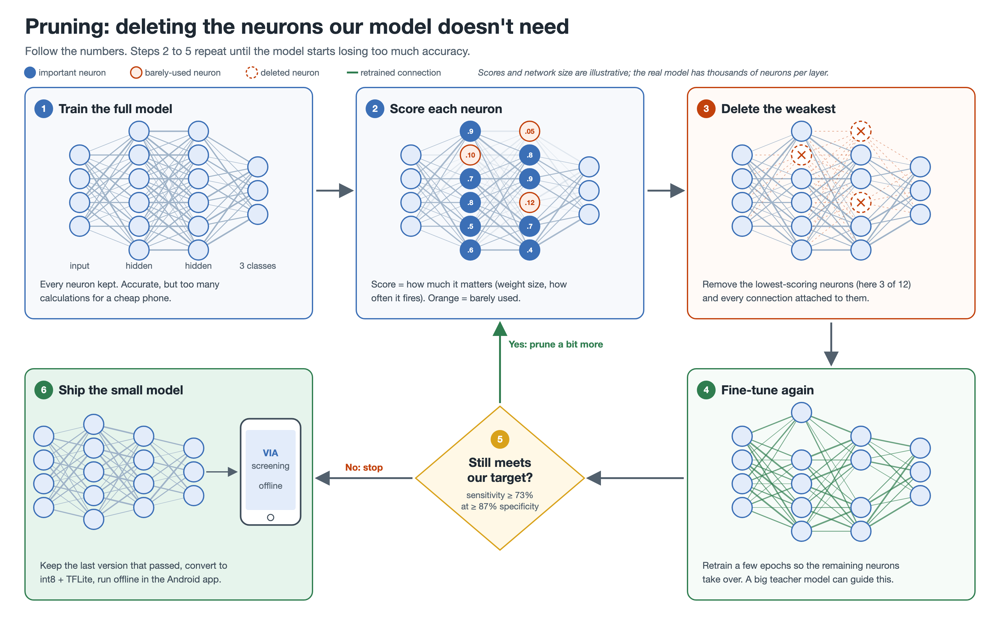

# Group 5: offline AI for VIA cervical cancer screening

EN.580.649 AI/ML for Global Health, Johns Hopkins, Fall 2026
Caroline Kelley · Kavinraj Srirangarayan Rangaraj · Luiza Brunelli · Maggie Ma

A phone app that works offline in low-resource clinics. A health worker takes a photo of the cervix after acetic acid (VIA), and the model:

1. **Classifies** it as negative, precancerous, or suspected cancer.
2. **Segments** it by outlining the acetowhite lesion.

## Plan (agreed Nov 4)

| Step | What |
|---|---|
| 1 | **EfficientNet-B3** backbone (ImageNet-pretrained) with a classification head and a segmentation head |
| 2 | **Prune** it: delete the filters that contribute least, fine-tune, repeat while it still meets the target |
| 3 | If it is still too big or loses too much accuracy: **distill** into a smaller student (MobileNetV3) |
| 4 | int8 quantization → TFLite → offline Android app |

**Accuracy target:** sensitivity ≥ 73% at ≥ 87% specificity (from the literature review in the preliminary notebook).

## Repo layout

| Path | What |
|---|---|
| `notebooks/Group5_VIA_Team_Notebook.ipynb` | Shared starter notebook: mounts Drive, copies the data to the runtime, loads the IARC labels |
| `notebooks/VIA_Accuracy_Target_preliminary.ipynb` | Kavin's preliminary experiments (EfficientNet-B0, MobileNetV3, 5-fold CV) |
| `src/via_data.py` | Loads the IARC + Jhpiego images into one labelled table |
| `labels/jhpiego_labels.csv` | VIA labels for the 115 Jhpiego flashcards |
| `docs/figures/` | Pruning / distillation explainers |

## Getting started

1. Open a notebook in Colab:
   - Team notebook: 
   - Preliminary results: 
2. **Runtime > Change runtime type > T4 GPU.**
3. Add the team Drive folder to your own Drive once: in Google Drive, open the **AI ML Final Project** folder menu > **Organise > Add shortcut > My Drive**.
4. Run the cells in order and sign in to Google Drive when asked.

## Data is not in this repo

This repo is **public**. The VIA images and spreadsheets stay in the team Drive folder (**AI ML Final Project**; sources are listed in the *Finalized Dataset* doc).

- Never commit images, `.xlsx` files, model checkpoints, or notebooks with outputs that show patient photos or case rows.
- Before committing a notebook: **Edit > Clear all outputs**, then save.
- Put results worth keeping (metrics, plots without patient images) in the README or a short markdown cell.

## Working together

1. Work in Colab as usual.
2. To save your work here: in Colab, **File > Save a copy in GitHub**, pick this repo, and use a branch named after you (e.g. `caroline/segmentation`).
3. Open a pull request so the others can see what changed, then merge into `main`.

Keep each pull request to one thing (one experiment or one fix) and use short conventional commit messages, e.g. `feat: add segmentation head` or `fix: data path for team folder`.

## Preliminary results (Nov 2, EfficientNet-B0 / MobileNetV3, 300 images, 5-fold CV)

| Model | AUC (95% CI) | Sensitivity at 86.7% specificity | 3-class accuracy |
|---|---|---|---|
| Frozen EfficientNet-B0 + logistic regression | 0.773 | 0.46 | 0.673 |
| Fine-tuned EfficientNet-B0 | 0.842 (0.80–0.88) | 0.61 | 0.720 |
| Fine-tuned MobileNetV3-Large | 0.856 (0.81–0.90) | 0.64 | 0.730 |
| Average of the two | 0.862 | 0.61 | 0.733 |

None of these meet the target yet; the move to EfficientNet-B3 is meant to close that gap.
